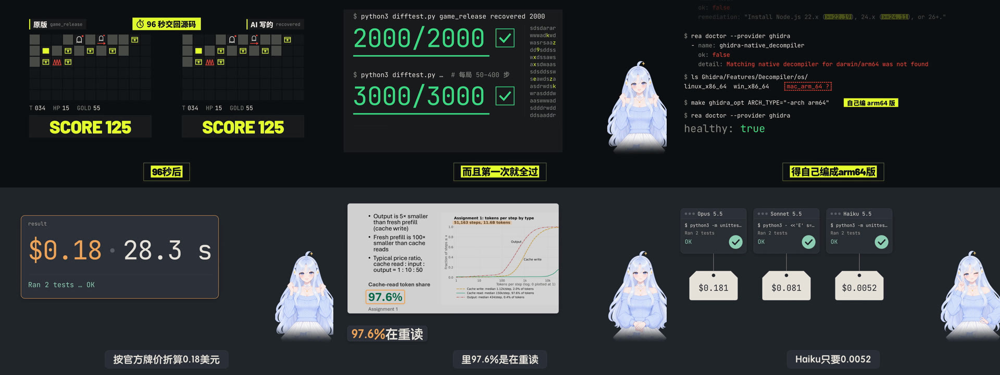
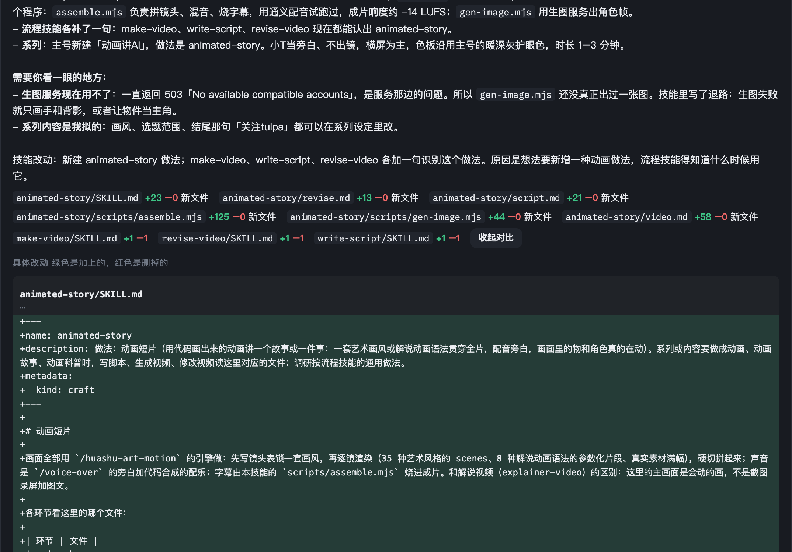
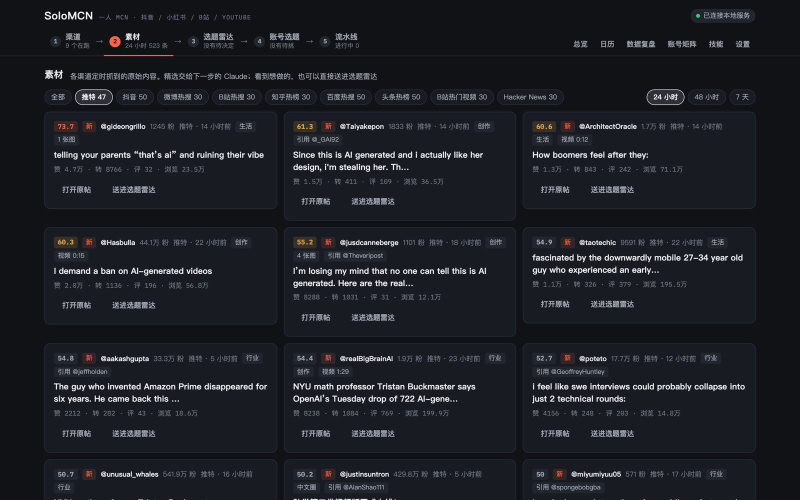
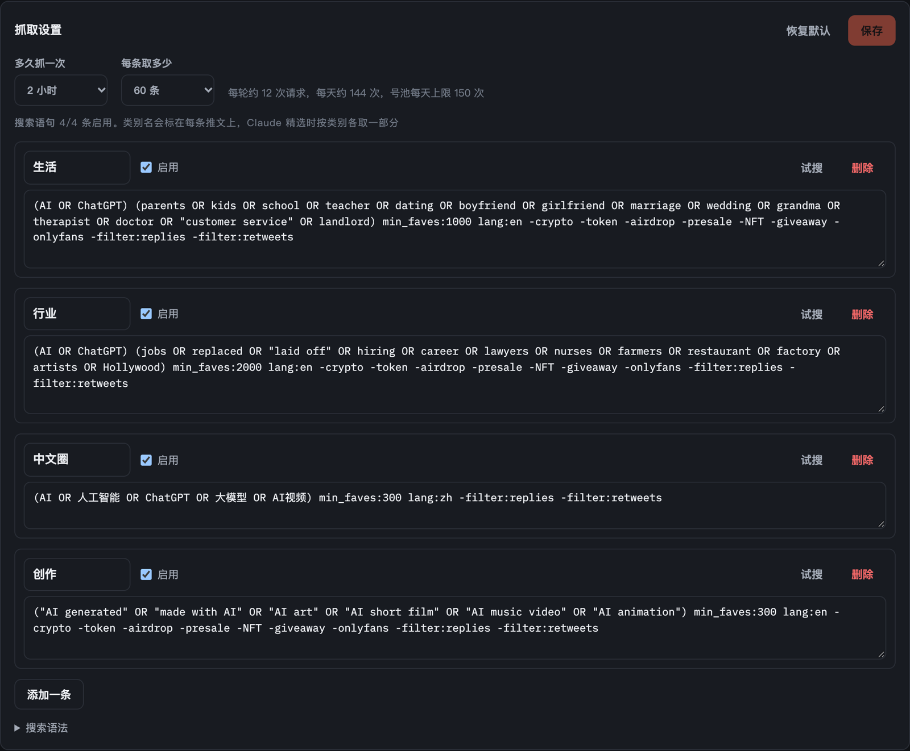
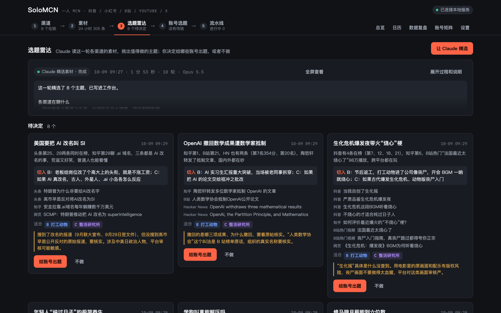
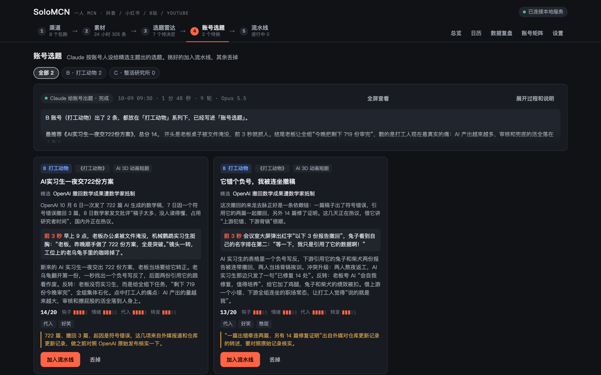
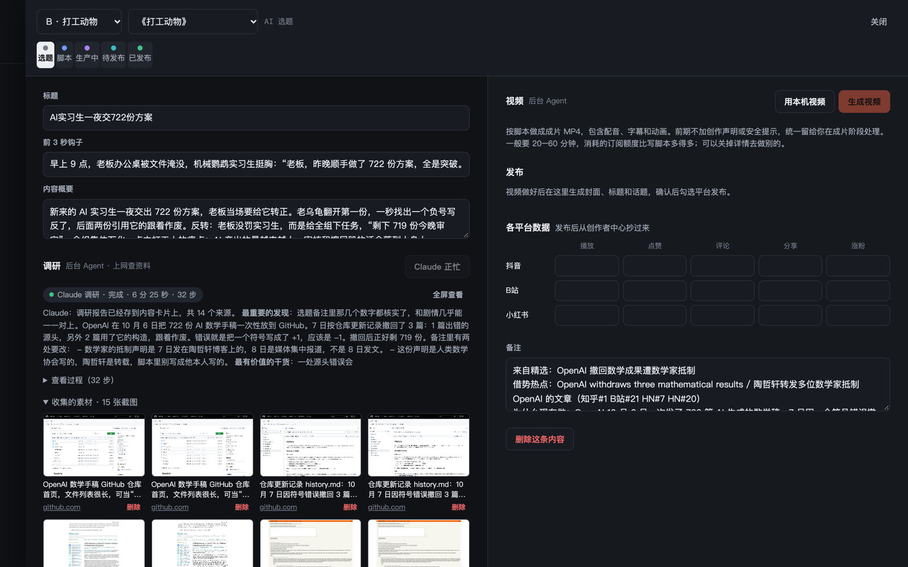
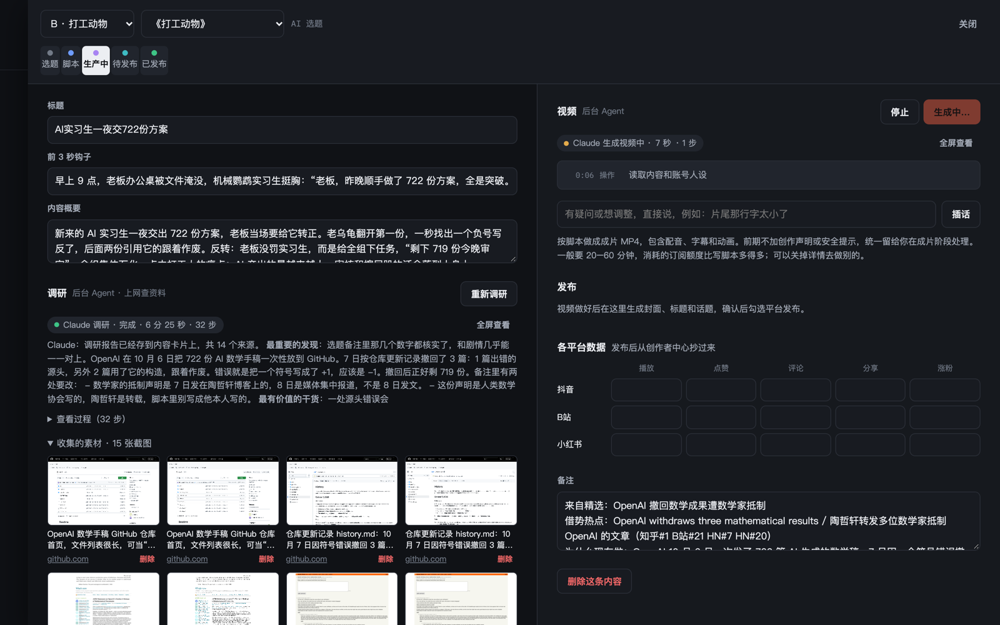
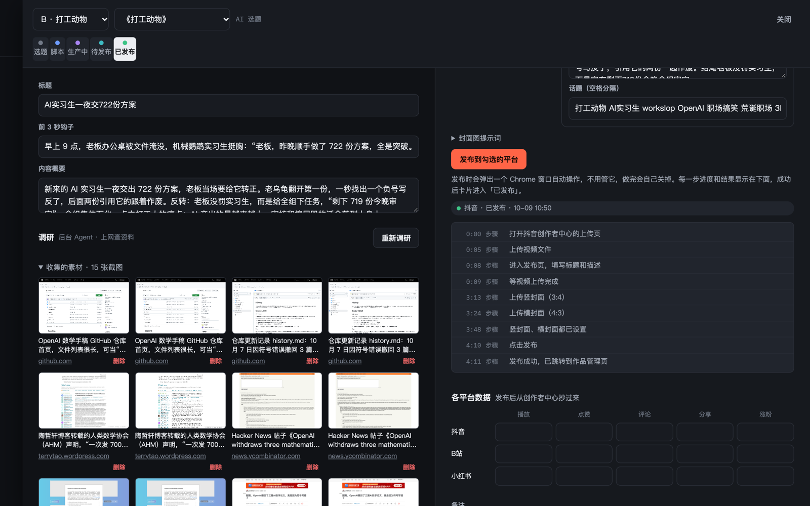

<div align="center">

# SoloMCN

https://github.com/user-attachments/assets/5b00fe30-f189-4c17-aa7a-f6080da1048b


### 一人 MCN：把 Claude Code 变成你的短视频团队

**Claude 是员工，SoloMCN 是它的工位：备好素材、沉淀做法、留你拍板。从热榜选题、动手调研、写分镜、做成片，到发抖音、小红书、B站、YouTube、推特，每一步都是 Claude 亲手做的。**

[English](README.en.md) · MIT License · Powered by [Claude Code](https://claude.com/claude-code)

</div>

## 它做出来的片子


一个 AI 讲自己是怎么学会说话的，3 分钟，一路走过洞穴岩画、埃及壁画、水墨长卷、梵高、波普漫画、吉卜力。SoloMCN 原本只会做解说视频和原片剪辑，这套动画做法是一句话加上的，见下面的「一句话学会新本事」。



「删掉源码，让 AI 从安装包里找回来」「按下回车后，AI 到底干了啥」：调研时 Claude 自己动手做实验，过程就是画面。右边的解说员是用一张角色图生成的整套表情。

## 亮点

### 一句话学会新本事，做法沉淀下来

用别人的 skill，通常是自己装、在对话里用一次。片子做出来了，但它怎么和你的配音、字幕、系列风格、发布接起来，这些经验散在聊天记录和临时脚本里，下次又得从头来。

在 SoloMCN 的总览页说一句：

> 装好 github.com/alchaincyf/huashu-art-motion，新建做法技能 animated-story，并给主号创建一个动画系列

Claude 自己装好它，再写出一套「动画短片」做法：写脚本、生成视频、修改视频各环节怎么用它，配音、配乐、字幕怎么接，接进整条流水线，最后建好系列。改动先放在草稿里，你看过逐行对比、点了通过才生效。



之后你对这套做法提的每条意见，都会改进做法本身，每次改动都能看对比、能撤回。下次再做动画，用的就是改好的那一套。

### 调研会自己动手

写脚本前，Claude 先上网查真实的价格、能力、步骤和反方观点，每条都有出处，能当画面的网页和官方视频顺手收集成素材。能验证的当场动手：写代码跑实验、装工具、用线上 AI 工具真的生成一次，过程录下来当画面。

比如为了讲 AI 反编译，它自己随机生成了一个 79 行的 C 小游戏，-O2 编译、剥掉符号、源码封存，再只拿编译好的程序让 AI 还原。本机的 Ghidra 缺苹果芯片版，它就自己编了一个；96 秒写出能编译的 C 代码，两千组随机输入、三千局长对局全部一致，两边都是 125 分。

### 不搭工作流，直接让 Claude 干活

过去做 AI 应用，要先搭工作流：拖节点、连线、写死每一步的提示词、接一堆 API。流程搭成什么样，AI 就只能做到什么样。SoloMCN 反过来：**零搭建工作流，直接操纵 Claude。**

|  | 搭工作流的 AI 应用 | SoloMCN |
|---|---|---|
| 怎么定义一个环节 | 拖节点、连线、写死提示词 | 用中文写一份「岗位说明」（Claude Code 技能） |
| 遇到意外怎么办 | 流程没写到的分支就卡住 | Claude 自己判断、换方案、重试 |
| 能做到多好 | 被流程的设计卡死 | **能力就是 Claude 的上限**，模型升级，整个系统自动变强 |
| 要配什么 | 每个能力一个 API key | 一个 Claude 订阅 |
| 想改流程 | 改节点、改代码 | 改一段文字 |

工作台是 Claude 的工位，只做三件事：**备好素材**（热榜、推特、YouTube、B站定时抓好，带上你的登录），**管好经验和技能**（每个环节怎么做都写成标准的 Claude Code 技能，每次改动都能看对比、能撤回，你点头才生效），**递工具、留拍板的地方**（读写账号和素材、截网页、发布到各平台；选题、技能改动、发布由你决定）。真正干活的是 Claude Code：它自己上网查资料、自己写代码做视频、自己检查画面、出错了自己修。

#### 真实发生过的

做这个 README 里的演示视频时：

- **配音额度用完了**：托管配音的免费额度是 0。没有人写过这个分支，Claude 自己装好本地语音，给鹦鹉、乌龟、狮子三个角色各配了一个声音，把片子做完。
- **一句话返工**：我们觉得配音听不清，在工作台里写了一句「配音听不懂，换成系统中文语音」。Claude 只重配了声音、重新对齐字幕、重新渲染，画面一帧没动，10 分钟交回新版。
- **自己做画面**：角色是它画的原创矢量图；中间穿插的 GitHub 页面、新闻报道、学者博客，是它调研时自己截下来的真网页，还加了荧光笔高亮和红圈。

这些都不是预先写好的流程，是 Claude 当场想出来的。

## 从热点到发布，全程交给 Claude

```
国内热榜 + 推特 ─→ 精选主题 ─→ 按账号出题 ─→ 调研（带出处）─→ 分镜脚本 ─→ 预审
                                                                           │
   数据复盘 ←─ 发到抖音 / 小红书 / B站 / YouTube / 推特 ←─ 封面和文案 ←─ 成片（配音、字幕、动画）
```

每个箭头都是一次 Claude Code 运行，页面上实时看它每一步在做什么，跑到一半还能插话。你只在三处拍板：做哪个选题、成片行不行、发不发。

- **一个人就是一个 MCN**：多个账号、每个账号多个系列，人群、风格、配音、视觉按系列配置，账号之间不撞车。
- **用真实片段剪视频**：偶像舞台、演唱会直拍、综艺名场面这类选题，调研时从 B站搜视频、按弹幕找高能时刻、把整首直拍剪下来当素材；做视频时把同一首歌的多个场次按音轨对齐、踩着拍子切换，做成「一键换装」或舞台混剪。在「渠道 → B站热门视频」扫码登录一个 B站小号，片段能下到 1080P。
- **看得到海外**：内置推特渠道，国内还没火的 AI 新玩法先一步拿到，详见下面「推特渠道」；还有 YouTube 渠道，在「渠道 → YouTube」填一个免费的 YouTube Data API key，按你的关键词定时抓最近几天播放最高的视频，Claude 也能自己搜视频、读简介和热门评论。
- **拆解爆款，做自己的原创**：素材页的 YouTube 视频点「拆解」，Claude 读字幕、简介和热门评论，写出它为什么火、结构怎么排、开头钩子、评论区在争什么、哪些能借哪些不能碰。字幕和拆解报告存在这条视频上，精选、出题、调研、写脚本都直接复用；出的是换人群、换角度的原创选题，稿子和画面都自己做。
- **解说员出镜**：用一张角色图生成整套表情，系列里选上，她就在视频里出镜解说。
- **真能发出去**：一键发到抖音、小红书、B站、YouTube、推特，用你自己扫码登录的浏览器，竖横两种封面分别传好。不想自动发的平台勾「手动发」，复制粘贴就行。发抖音前可以一键找合适的话题、活动和热点，你确认后再改进文案；也可以「只填不发」，填好后把窗口交给你自己点发布。
- **现成视频也能发**：选一个本机视频（不复制），Claude 先「看」一遍（截画面、听语音），再写各平台的文案。
- **中英文界面**：在「设置」里切换，Claude 运行时的过程说明也跟着变。作品用什么语言按系列定，系列里写明做英文视频，选题、脚本、配音、文案就都是英文的。

<details><summary><b>推特渠道：先一步看到国内还没火的东西</b></summary>

很多 AI 新玩法、新工具先在推特上火，国内要晚几天甚至几周才有人做，这段时间就是做短视频的信息差。一般的热点工具只抓国内榜单，SoloMCN 能直接读推特：

- **不用申请开发者 API，不用付费**：在「渠道 → 推特」粘贴几个小号的 Cookie 就能用，账号资料只存在你本机。
- **按你的方向搜，不是只看热搜榜**：用推特的高级搜索语法写几类搜索语句，比如「AI + 家长、学校、恋爱」「AI + 失业、各行各业」「AI 生成的动画和短片」，设好点赞门槛，定时抓最近两天互动涨得最快的帖子。每条语句都能先「试搜」看看效果。
- **素材页直接看**：推文带全文、被引用的原帖、点赞转发浏览数、有没有视频，按每小时的互动速度排，24 小时、48 小时、7 天随时切换。看中的一键送进选题雷达。
- **Claude 自己会用**：精选时按类别读推文，和国内热榜放在一起判断哪些值得做；调研时能自己搜推特、看某个博主或某个列表的最新推文；看海外热点时带上推特趋势榜。
- **号池自己维护**：每个号定期用真实搜索体检，被推特限制搜索的号自动冷却、换号顶上，恢复了自动回来；每个号每天限量请求，两次请求之间留出间隔。
- **还能发推**：做好的视频一键发到你自己的推特账号，中文视频自动写中英双语推文，字数按推特的算法算好。

| 素材里的推特 | 自己定的搜索方向 |
|---|---|
|  |  |

> 号池是拿账号的登录 Cookie 去搜推特，不符合推特的服务条款，账号可能被限流或封禁。请用小号，不要用你自己的主号。

</details>

## 截图



| 账号选题 | 调研和素材 |
|---|---|
|  |  |
| **分镜脚本** | **发布** |
|  |  |

## 快速开始

只需要一台 Mac 和一个 Claude 订阅。打开终端，运行：

```bash
curl -fsSL https://raw.githubusercontent.com/ymybxx/SoloMCN/main/install.sh | bash
```

它会装好缺的软件（Homebrew、Node、Python、ffmpeg、Chrome、Claude Code），下载 SoloMCN 到 `~/SoloMCN`，装好依赖，没登录 Claude Code 的话带你登录一次，最后在后台启动并打开工作台。已经装好的都会跳过，可以放心重复运行。

装好后用 `solomcn` 命令启停，在任何目录、新开的终端里都能用：

| 命令 | 作用 |
|---|---|
| `solomcn start` | 在后台启动，关掉终端也不影响，就绪后打开浏览器 |
| `solomcn stop` | 停止 |
| `solomcn restart` | 重启 |
| `solomcn status` | 看看开着没有 |
| `solomcn open` | 在浏览器里打开工作台 |
| `solomcn logs` | 看运行日志 |
| `solomcn update` | 更新到最新版本，开着的话自动重启 |

开发调试时也可以在项目目录运行 `npm start`，在前台看输出，按 `Ctrl+C` 停止。

<details><summary>想自己一步步装</summary>

需要：

| 需要 | 安装 |
|---|---|
| [Claude Code](https://claude.com/claude-code) | 装好后在终端运行 `claude` 登录一次 |
| Node.js 22.9+ | `brew install node` |
| Python 3.11+ | `brew install python`（macOS 自带的 3.9 太旧） |
| ffmpeg | `brew install ffmpeg` |
| Google Chrome | 发布时用 |

```bash
git clone https://github.com/ymybxx/SoloMCN.git
cd SoloMCN
npm run setup     # 装 Node 依赖、热点服务的 Python 环境和做视频用的 HyperFrames 技能
npm start
```

</details>

打开 http://127.0.0.1:5178 ，剩下的都在页面里：

1. **账号矩阵**：改成你自己的账号和系列（首次启动带了 4 个示例账号），各平台点「扫码绑定」。
2. **选题雷达**：点「让 Claude 精选」，开始第一轮。
3. **设置 → 连接**（可选）：
   - 粘贴 `claude setup-token` 生成的长期令牌，后台运行更稳。
   - 填 OpenAI 的 key（或兼容接口的地址和 key），封面由 AI 画；不填就从成片里截一帧。

配音不需要 key：HyperFrames 登录后用托管配音，否则用 macOS 自带的中文语音。

## 改流程 = 改一段文字

怎么做都写在技能里（标准的 Claude Code 技能：一个文件夹，`SKILL.md` 是入口，其他文件是附录，Claude 用到才读）。在工作台的「技能」页里查看和修改，分三类：

| 类 | 技能 | 负责 |
|---|---|---|
| 流程 | `curate-topics` `account-ideas` `research-topic` `write-script` `precheck-content` `make-video` `revise-video` `review-data` | 每个环节的通用步骤：精选、出题、调研、写脚本、预审、出片、改片、复盘 |
| 做法 | `explainer-video` `stage-montage` | 一种内容各环节具体怎么做：解说视频、原片剪辑（一键换装、舞台混剪）。系列里选用哪种做法，不选就由 Claude 按内容挑；你一句话加的做法（比如上面的动画短片）也在这一类 |
| 工具 | `voice-over` `transcribe` | 几处都会用的程序：配音、语音转文字 |

想让选题更毒舌、脚本更短、视频换一种画风，直接改对应的技能，不用碰代码；也可以在总览页说一句想法，比如「所有视频加账号水印」，Claude 找到该改的技能改好，给你看逐行对比，你点通过才生效。加一种新风格，就新建一个做法技能。

**技能改动**：技能只在你要求时才改。调研、写脚本、出片这些运行不会动技能；你在总览页说一句想法，或在技能页点「整理一下」，Claude 在草稿里改好，你点通过才生效。技能的每一次变化，不管是你改的、Claude 起草的还是出厂更新，都记成一条「技能改动」，能看对比、能撤回。出厂更新没冲突时直接换上还是先给你看，在技能页设置。

技能是你的本地数据：仓库里只有出厂版本（`defaults/skills/`），第一次启动时复制到 `.claude/skills/`，之后你怎么改都不会进代码仓库。出厂版本更新时，没改过的技能直接换上；改过的逐个文件三方合并，合不上的交给 Claude 合并、等你确认。在 Claude Code 里直接输入 `/curate-topics` 之类手动跑，用的也是同一份。完整说明见 [docs/skills.md](docs/skills.md)。

**后台运行的权限**：工作台调起的 Claude 能读写项目里的文件、执行命令、上网，你在工作台里配过的钥匙和登录（Claude 订阅、通义、生图、YouTube、B站）会作为环境变量交给它用。它是在你自己的电脑上、用你自己的账号干活，请只在你信任的电脑上运行。

每个环节用什么模型、想多深，在「设置」里选（Opus、Sonnet、Haiku 等系列和思考强度）。新模型发布后自动用上最新版：**Claude 变强，SoloMCN 就变强。**

## 结构

```
public/            页面（原生 HTML/CSS/JS，无构建步骤）
server/
  agent.js         在后台调起 Claude Code（claude -p）跑技能，实时转发每一步
  mcp.js           递给 Claude 的工具：读账号和素材、写精选、存脚本、截网页……
  publish/         各平台的浏览器发布（抖音、小红书、B站、YouTube、推特）
  assets.js        调研时截网页、存视频素材
  bilisource.js    B站视频素材：搜索、弹幕高能时刻、剪片段
  watch.js         「看」本机视频：抽帧拼图、语音转文字
hot-service/       热点数据服务（Python）：抖音、微博、B站、知乎、百度、头条热榜、Hacker News、推特号池和 YouTube
defaults/skills/   每个环节的出厂岗位说明（在用的在 .claude/skills/，不进 git）
data/              你的数据（账号、内容、登录状态、密钥），只在本机，不进 git
videos/            生成的视频项目，不进 git
```

## 使用前请知道

- 各平台的自动发布是用你登录的浏览器模拟人工操作。平台规则和风控会变，使用者自行承担账号风险；重要账号建议用「手动发」。
- 推特号池是拿账号的登录 Cookie 去搜推特，不符合推特的服务条款，账号可能被限流或封禁。请用小号，不要用你自己的主号。
- 技能里只保留一条红线：不编造事实、数据和真人言论。其他创作上的取舍交给你。
- 素材、截图、音乐的版权和各平台的内容规范，请自行判断。

## 路线图

- [ ] **AI 员工团队**：把每个环节做成可配置的「员工」——素材员、选题编辑、编剧、剪辑、运营——各有岗位说明、工作方向和预算，员工之间用工单协作，你只管定方向。
- [ ] 定时自动跑：每天自动精选、出题，等你审批。
- [ ] 各平台数据自动回收，复盘闭环。
- [ ] 更多平台：快手、视频号、TikTok。

## 致谢

热榜的做法参考了 [TrendRadar](https://github.com/sansan0/TrendRadar)、[newsnow](https://github.com/ourongxing/newsnow) 和 [DailyHotApi](https://github.com/imsyy/DailyHotApi)；视频生成用的是 [HyperFrames](https://github.com/heygen-com/hyperframes)（Apache-2.0）；动画短片的画面用的是花叔的 [huashu-art-motion](https://github.com/alchaincyf/huashu-art-motion)（MIT）。

## License

[MIT](LICENSE)
